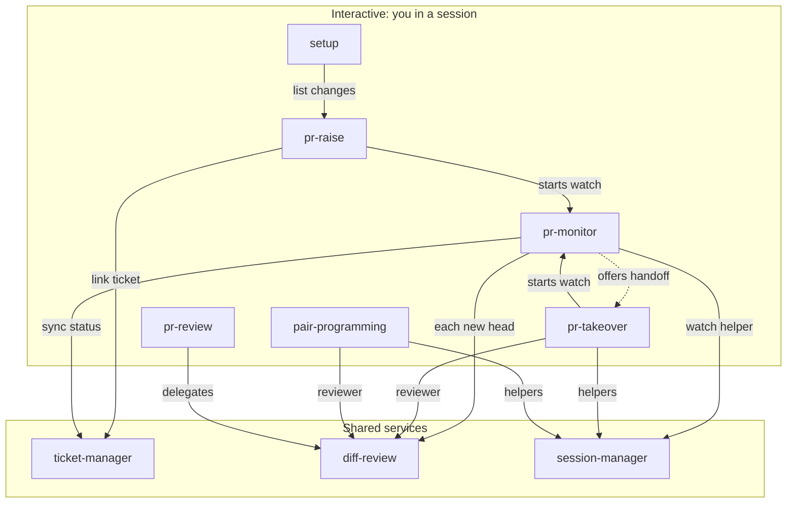

# ai-skills

Personal agent skills, one directory each.

## Skills graph

Solid arrows load or start the skill; the dashed one is an offer you decide on.



Every skill loads `skill-improve` when its output misses. `whatsapp-backup`, `oss-explore` and `machines` have no other links.

## Setup

```bash
./install.sh                                   # from the repo root; symlinks skills into ~/.claude/skills, then runs setup/install.sh
$EDITOR ~/.config/ticket-manager/config.toml   # base_url (with /api), workspace_id, workspace_slug
$EDITOR ~/.config/machines/config.toml         # your tailnet machines: login, role, what's installed
```

`install.sh` also links `CODING_STANDARD.md` into `~/.claude` and `~/.codex` and adds one line that points to it: `@CODING_STANDARD.md` in `~/.claude/CLAUDE.md`, a read-this line in `~/.codex/AGENTS.md`. `RESEARCH.md` is linked the same way, with a read-this line in both files and no import, so it loads only when there is research to do. Edit both here, not the links.

Third-party plugins, skills and CLI tools are listed in `setup/third-party.json`; `setup/install.sh` installs them (`--check` only reports, and lists skill folders nobody recorded). Ask the `setup` skill to add one.

Optional: `pr-monitor/launchd/install-heartbeat.sh` restarts monitor loops that died and syncs tickets on merge, every 10 minutes (GitLab MRs, monitors on T3, macOS) (`--uninstall` removes it).

In `~/.claude/settings.json`, add pr-raise's guard so no MR is opened outside it:

```json
"PreToolUse": [{"matcher": "Bash", "hooks": [{"type": "command",
  "command": "python3 ~/.claude/skills/pr-raise/hooks/mr_create_guard.py"}]}]
```
