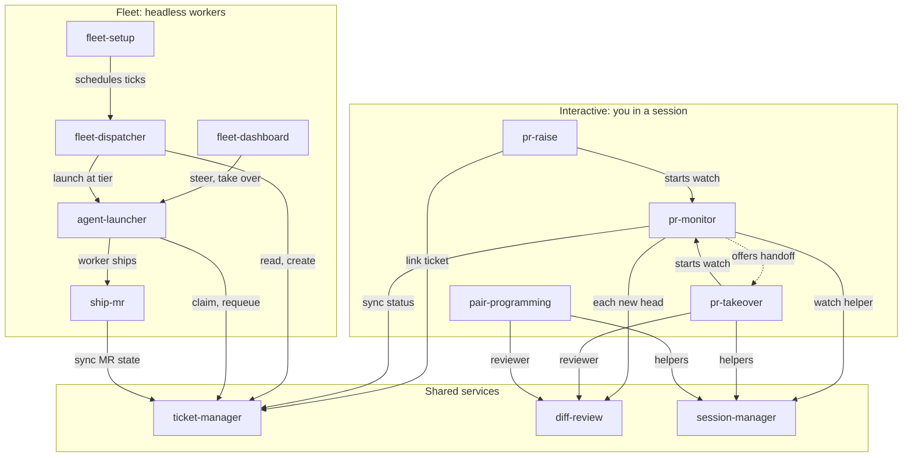

# ai-skills

Personal agent skills, one directory each. After the graph, this page covers the agent fleet, which is
the set of skills in its table plus `bin/`, `lib/` and `config/`.

## Skills graph

Solid arrows load or start the skill; the dashed one is an offer you decide on.



Every skill loads `skill-improve` when its output misses. `whatsapp-backup` and `oss-explore` have no other links.

## Agent fleet

Tickets in (through `ticket-manager`, Kaneo today) → Haiku routes by complexity → Claude Code workers in isolated
worktrees → GitLab MRs out. A read-only dashboard, reachable through a Cloudflare tunnel,
shows all of it.

```
          cron: fleet tick            you: fleet ask "…"
                  │                          │
                  ▼                          ▼
      ┌──────────────────────────────────────────────┐
      │ fleet-dispatcher (Haiku)  — the only entry   │
      │  reads tickets, picks tier T0–T3, launches   │
      └───────────────┬──────────────────────────────┘
                      │ agent-launcher
       ┌──────────────┼──────────────┐
       ▼              ▼              ▼
   worker (haiku)  worker (sonnet)  worker (opus)    one git worktree + branch each
       │              │              │
       └──── ship-mr: push → glab mr create → comment + move ticket ────┘
                      │
   ~/.agent-fleet/{runs/*, events.jsonl} ──► fleet-dashboard ──► cloudflared
```

| Skill | Who uses it | Purpose |
|---|---|---|
| `fleet-dispatcher` | Haiku router | Triage + complexity rubric, TICK and ASK modes |
| `ticket-manager` | router, workers | Reads tickets, comments, and moves them with `tm`; shared with `pr-raise` and `pr-monitor` |
| `agent-launcher` | router, you | Worktree + detached `claude -p` worker per ticket; status/kill/retry |
| `ship-mr` | workers | Verify, push, open GitLab MR, link ticket — or report blocked |
| `fleet-dashboard` | you | Web UI + cloudflared tunnel; opt-in steering and takeover terminal |
| `fleet-setup` | you | Install, `doctor`, config, project mapping, schedule, services, bundle to another VM |

## Setup

On a new machine, use the `fleet-setup` skill: `fleet-setup/scripts/setup.sh all`, then
follow `setup.sh doctor`. Manual equivalent:

```bash
~/codebase/ai-skills/install.sh                  # symlinks skills into ~/.claude/skills, fleet into ~/.local/bin
$EDITOR ~/.config/ticket-manager/config.toml   # base_url (with /api), workspace_id, workspace_slug
$EDITOR ~/.agent-fleet/config.env       # KANEO_API_KEY, DASHBOARD_TOKEN
python3 ~/codebase/ai-skills/lib/fleet.py health         # tracker reachable + authorised
KANEO_API_KEY=… ~/codebase/ai-skills/ticket-manager/tm projects   # project ids → ~/.agent-fleet/projects.json
```

Then:

```bash
fleet ask "Fix the typo in the Incidents empty state"   # one-off, through the router
fleet tick                                              # one dispatch pass
fleet status --all
fleet dashboard & fleet tunnel quick
```

Run ticks on a schedule (cron needs PATH for `claude`/`glab`):

```cron
*/5 * * * * PATH=/root/.local/bin:/usr/bin:/bin /root/.local/bin/fleet tick >> /root/.agent-fleet/tick.log 2>&1
```

`fleet tick` checks for free slots and pickable tickets in plain Python first, so Haiku is
only called when there is work to route.

## State
Everything is under `~/.agent-fleet` (override with `FLEET_HOME`): `config.env`,
`projects.json`, `events.jsonl`, `runs/<run>/`, `worktrees/<run>/`, `dispatcher/*.log`.
