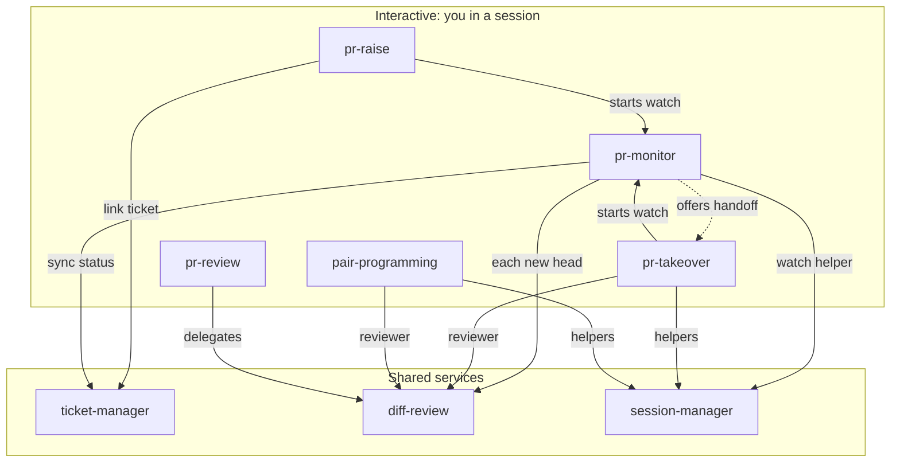

# ai-skills

Personal agent skills, one directory each.

## Skills graph

Solid arrows load or start the skill; the dashed one is an offer you decide on.



Every skill loads `skill-improve` when its output misses. `whatsapp-backup` and `oss-explore` have no other links.

## Setup

```bash
~/codebase/ai-skills/install.sh                # symlinks skills into ~/.claude/skills
$EDITOR ~/.config/ticket-manager/config.toml   # base_url (with /api), workspace_id, workspace_slug
```

In `~/.claude/settings.json`, add pr-raise's guard so no MR is opened outside it:

```json
"PreToolUse": [{"matcher": "Bash", "hooks": [{"type": "command",
  "command": "python3 ~/.claude/skills/pr-raise/hooks/mr_create_guard.py"}]}]
```
